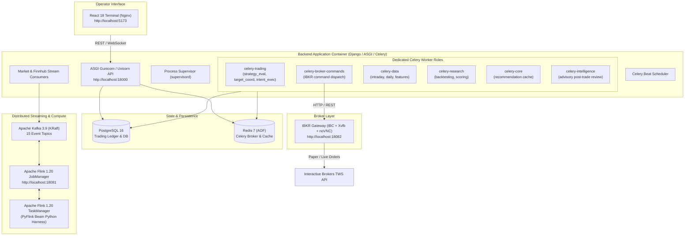
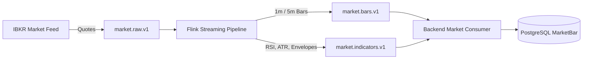

# Finflock Systems Trading Engine

Institutional-grade, event-driven systematic trading engine designed for automated multi-asset execution (equities and defined-risk options), real-time streaming analytics, headless Interactive Brokers (IBKR) connectivity, and an advisory post-trade AI intelligence layer.

---

## Table of Contents
- [1. System Architecture](#1-system-architecture)
- [2. Subsystems & Technology Stack](#2-subsystems--technology-stack)
- [3. Repository Directory Structure](#3-repository-directory-structure)
- [4. Container Ecosystem & Topology](#4-container-ecosystem--topology)
- [5. System Requirements & Hardware Prerequisites](#5-system-requirements--hardware-prerequisites)
- [6. Local Setup with Docker](#6-local-setup-with-docker)
  - [Step 1: Environment File Configuration](#step-1-environment-file-configuration)
  - [Step 2: Starting the Full Stack via Docker Compose](#step-2-starting-the-full-stack-via-docker-compose)
  - [Step 3: Alternative - All-in-One Unified Container](#step-3-alternative---all-in-one-unified-container)
  - [Step 4: Frontend Development Server (Optional)](#step-4-frontend-development-server-optional)
- [7. Verifying System Health & Readiness](#7-verifying-system-health--readiness)
- [8. Core Engine Workflows](#8-core-engine-workflows)
  - [A. Real-Time Streaming & Market Data Pipeline](#a-real-time-streaming--market-data-pipeline)
  - [B. Strategy Lifecycle & Order Execution Path](#b-strategy-lifecycle--order-execution-path)
  - [C. AI Post-Trade Intelligence & Learning Loop](#c-ai-post-trade-intelligence--learning-loop)
- [9. Key Configuration & Operational Safeguards](#9-key-configuration--operational-safeguards)
- [10. Troubleshooting & FAQ](#10-troubleshooting--faq)

---

## 1. System Architecture

Finflock Systems Trading Engine is architected around deterministic financial safety, high-throughput asynchronous event streaming, and strict fail-closed order risk controls.



---

## 2. Subsystems & Technology Stack

| Component | Technology | Description |
| :--- | :--- | :--- |
| **Frontend Terminal** | React 18, TypeScript, Vite, Tailwind CSS, TanStack Query, Lightweight Charts, Nginx | Institutional dark trading terminal displaying portfolios, positions, order blotter, real-time charts, strategy lifecycles, and noVNC sessions. |
| **Backend Core** | Django 5.1, Django REST Framework, Uvicorn, Gunicorn (ASGI) | Core business logic, order management (OMS), pre-trade risk checks, portfolio optimization, and multi-tenant API. |
| **Task Queue** | Celery 5.4, Redis 7 (Append-Only File) | 6 isolated worker processes to ensure trading orders are never starved by slow research tasks or LLM reviews. |
| **Event Bus** | Apache Kafka 3.9 (KRaft mode) | Real-time quote streaming, order status events, execution fills, audit logs, and risk decisions. |
| **Stream Analytics** | Apache Flink 1.20.1, PyFlink | In-flight calculation of technical indicators (RSI, ATR, Wilder envelopes), market bars, and streaming data quality marks. |
| **Broker Bridge** | Dockerized IBKR Gateway, IBC, `ib_async`, noVNC, Xvfb | Headless bridge to Interactive Brokers paper/live environments with remote desktop debugging. |
| **Advisory AI** | Google Gemini / DeepSeek via QCH LiteLLM proxy | Post-trade reviews, mistake diagnostics, and deterministic parameter advisory (never in the order execution path). |

---

## 3. Repository Directory Structure

```text
finflocksystems-trading-engine/
│
├── finflocksystems-trading-engine-backend/
│   └── finflocksystems-trading-engine-338a2c5b3f2a/
│       ├── apps/                     # Django domain applications
│       │   ├── accounts/             # Broker accounts & balances
│       │   ├── allocation/           # Portfolio capital allocation
│       │   ├── audit/                # Append-only audit logs & outbox
│       │   ├── broker_gateway/       # IBKR Gateway session management
│       │   ├── execution/            # Command dispatch & fill attribution
│       │   ├── instruments/          # Equities, contracts & option chains
│       │   ├── intelligence/         # Advisory AI layer (Gemini/DeepSeek)
│       │   ├── market_data/          # Market feeds & fallback providers
│       │   ├── market_streams/       # Kafka consumers & stream state
│       │   ├── oms/                  # Order intents & state machines
│       │   ├── portfolios/           # Portfolios, positions & ledgers
│       │   ├── position_sizing/      # Sizing policies & constraints
│       │   ├── rebalancing/          # Portfolio rebalance engine
│       │   ├── reconciliation/       # Broker position reconciliation
│       │   ├── research/             # Strategy backtesting & optimization
│       │   ├── risk/                 # Pre-trade risk & kill switches
│       │   └── strategies/           # Strategy definitions & instances
│       ├── config/                   # Django settings, ASGI, Celery & URLs
│       ├── docs/                     # Architectural specs & intelligence notes
│       ├── gateway/                  # IB Gateway container source & tests
│       ├── scripts/                  # Cluster bootstrapping & Flink job submitters
│       ├── streaming/                # PyFlink streaming pipelines
│       ├── Dockerfile                # Backend production Dockerfile
│       ├── entrypoint.sh             # Self-bootstrapping startup script
│       ├── supervisord.conf          # Process supervisor configuration
│       └── requirements.txt          # Python dependencies
│
├── finflocksystems-trading-engine-frontend/
│   └── finflocksystems-trading-engine-14a4bbba0c19/
│       ├── src/                      # React 18 TypeScript source code
│       │   ├── api/                  # API client & query definitions
│       │   ├── components/           # UI panels, forms & modals
│       │   ├── routes/               # Terminal routes (dashboard, blotter, etc.)
│       │   └── stores/               # Zustand local state & TanStack queries
│       ├── Dockerfile                # Frontend Nginx production Dockerfile
│       ├── nginx.conf.template       # Nginx template for runtime config injection
│       └── package.json              # Node dependencies
│
├── Dockerfile                        # Unified root Dockerfile (Frontend + Backend)
├── docker-compose.yml                # Master local development Docker Compose stack
├── .env.example                      # Root environment configuration template
├── nginx.conf                        # Nginx reverse proxy for unified container
├── supervisord.conf                  # Supervisord configuration for unified container
└── README.md                         # Project documentation (this file)
```

---

## 4. Container Ecosystem & Topology

When running via [`docker-compose.yml`](file:///c:/Users/gupta/Desktop/finflocksystems-trading-engine/docker-compose.yml), 8 microservices are launched:

| Service Name | Base Image / Source | Host Port | Role |
| :--- | :--- | :--- | :--- |
| **`postgres`** | `postgres:16-alpine` | `5432` (internal) | PostgreSQL database storing trading state, accounts, ledgers, and AI intelligence tables. |
| **`redis`** | `redis:7-alpine` | `6379` (internal) | Redis message broker for Celery queues and concurrency limits. Runs with `--appendonly yes`. |
| **`kafka`** | `apache/kafka:3.9.0` | `9092` (internal) | Event streaming bus in KRaft mode managing 15 core event topics. |
| **`flink-jobmanager`**| `flink:1.20.1-scala_2.12-java17` | `18081:8081` | Flink cluster coordinator and web dashboard. |
| **`flink-taskmanager`**| `flink:1.20.1-scala_2.12-java17`| Internal | Distributed compute node executing PyFlink Python Beam pipelines. |
| **`paper-ibkr-gateway`**| `trading-engine-ib-gateway` | `18082:8080` | Headless IBKR Gateway running IBC auto-login, virtual display (Xvfb), and noVNC on `/novnc/`. |
| **`backend`** | `./finflocksystems-trading-engine-backend/...` | `18000:8000` | Django 5.1 ASGI web API, 6 Celery workers, Celery Beat, and Kafka consumers. |
| **`frontend`** | `./finflocksystems-trading-engine-frontend/...` | `5173:8000` | React 18 trading terminal served through Nginx. |

---

## 5. System Requirements & Hardware Prerequisites

> [!IMPORTANT]
> **RAM Allocation Requirement (Minimum 12 GB RAM)**:
> The streaming cluster (Flink TaskManager JVM + Beam Python harnesses) and the trading engine (Django + 6 Celery workers) require at least **12 GiB to 16 GiB of memory** allocated to Docker Desktop.
>
> If Docker is allocated less than 8 GiB, the Flink TaskManager will be OOM-killed during checkpointing, causing jobs to restart continually with `REQUIRED_FLINK_JOBS_NOT_RUNNING`.

### Prerequisites:
1. **Docker Desktop**: Version 20.10+ (with WSL 2 backend on Windows).
2. **Docker Compose**: Version v2.x+.
3. **RAM**: 16 GB+ recommended on the host system.

---

## 6. Local Setup with Docker

### Step 1: Environment File Configuration

Copy the example environment template to create `.env` in the root directory:

```powershell
cp .env.example .env
```

Review or edit `.env`. The default values work out of the box for local validation:
```dotenv
# Passwords and secrets
LOCAL_DB_PASSWORD=H95M5GblRGJleTumK0lYWg2QWB0W
REDIS_PASSWORD=redis_local_pw_123
LOCAL_DJANGO_SECRET=django-insecure-secret-key-for-local-development-32chars
LOCAL_GATEWAY_TOKEN=local-gateway-token-secret-32chars-min
LOCAL_NOVNC_PASSWORD=novnc_local_pass
LOCAL_ENCRYPTION_KEY=8rAsGODCypce6xNBeQMmXi5BInJMuU8PTnhdGDIIsc8=

# Broker credentials (paper account or demo)
BROKER_ADAPTER=ib_async
IBC_TRADING_MODE=paper
IB_USERNAME=edemo
IB_PASSWORD=demouser

# Keep LLM provider as 'fake' for offline testing (no API credits required)
INTELLIGENCE_LLM_PROVIDER=fake
CLEANUP_DATABASE_ON_START=false
ALLOW_LIVE_TRADING=false
```

---

### Step 2: Starting the Full Stack via Docker Compose

Run from the root directory:

```powershell
docker-compose up -d
```

#### What happens during the initial boot:
1. **Infrastructure services** (`postgres`, `redis`, `kafka`, `flink-jobmanager`, `paper-ibkr-gateway`) start and wait for their health checks to turn healthy.
2. The **backend** container executes [`entrypoint.sh`](file:///c:/Users/gupta/Desktop/finflocksystems-trading-engine/finflocksystems-trading-engine-backend/finflocksystems-trading-engine-338a2c5b3f2a/entrypoint.sh):
   - Waits for PostgreSQL and runs Django database migrations.
   - Creates the 15 required Kafka event topics via `scripts/ensure_kafka_topics.py`.
   - Submits the PyFlink streaming job (`market-pipeline-v1`) to the Flink JobManager.
   - Seeds built-in strategies via `python manage.py seed_strategy_definitions`.
   - Launches `supervisord` running Gunicorn and all 6 Celery worker roles.
3. The **frontend** container compiles and serves the React UI via Nginx on port `5173`.

To monitor the startup logs in real-time:
```powershell
docker-compose logs -f backend
```

---

### Step 3: Alternative - All-in-One Unified Container

If you prefer building a single container that packages both the Frontend and Backend together in one image:

```powershell
# Build the unified image from the root directory
docker build -t finflock-trading-engine:latest .

# Run via Docker Compose unified profile
docker-compose --profile unified up -d app-unified
```
In this mode, Nginx serves the React UI on `http://localhost:8000` and reverse-proxies `/api/v1/` to the internal ASGI Gunicorn process.

---

### Step 4: Frontend Development Server (Optional)

If you are developing frontend components and need instant hot-reload without rebuilding Docker images:

```powershell
cd finflocksystems-trading-engine-frontend\finflocksystems-trading-engine-14a4bbba0c19
npm install
npm run dev
```
The Vite development server runs at `http://localhost:5173` and automatically proxies `/api/v1` calls to the Docker backend at `http://localhost:18000`.

---

## 7. Verifying System Health & Readiness

| Check | URL | Expected Response | Description |
| :--- | :--- | :--- | :--- |
| **Backend Liveness** | `http://localhost:18000/healthz` | `ok` | Confirms the ASGI web server is responsive. |
| **Backend Readiness** | `http://localhost:18000/readyz` | `{"ok":true,"data":...}` | Checks database and Redis cache readiness. |
| **Execution Readiness** | `http://localhost:18000/api/v1/execution/readiness/` | `{"status":"READY"}` | Proves all Celery workers, Kafka topics, and Flink jobs are running. |
| **Flink Dashboard** | `http://localhost:18081` | Web UI | Displays JobManager status, TaskManagers (2 slots), and `market-pipeline-v1`. |
| **IBKR noVNC Desktop** | `http://localhost:18082/novnc/` | Web GUI | Remote desktop into the IB Gateway container to view 2FA or login screens. |
| **Trading Terminal UI** | `http://localhost:5173` | React Terminal | Main operator UI for strategies, orders, and portfolio builder. |

---

## 8. Core Engine Workflows

### A. Real-Time Streaming & Market Data Pipeline


### B. Strategy Lifecycle & Order Execution Path
1. **Strategy Activation**: Strategy instance moves from `DISABLED` -> `WARMING_UP` until required historical bars and indicators have arrived.
2. **Signal & Target Generation**: Strategy evaluates live market bars against indicators and emits portfolio targets (`strategy.targets.v1`).
3. **Target Coordination**: Rebalance planner groups targets, checks portfolio allocations, and derives `OrderIntent` objects.
4. **Pre-Trade Risk Engine**: Validates kill switches, maximum position limits, and margin reservations.
5. **Broker Command Dispatch**: `celery-broker-commands` issues commands to the IBKR Gateway container.
6. **Execution & Reconciliation**: Fills arrive from IBKR, write append-only cash and position ledgers, and reconcile against broker snapshots.

### C. AI Post-Trade Intelligence & Learning Loop
- **Advisory Only**: The AI layer never executes orders or mutates strategy versions automatically.
- **Episode Tracking**: When an attributed trade closes, an `EpisodeEvidenceSnapshot` is frozen.
- **Deterministic Metrics**: Versioned mathematical metrics (P&L, slippage, MAE/MFE, hold time) are calculated by deterministic Python code—the LLM is never allowed to calculate numbers.
- **Rule Analyzers & Grounding**: Rule analyzers run first; the LLM (Gemini / DeepSeek) reviews the evidence and must cite explicit evidence keys in its output JSON.
- **Lesson Bank**: Validated insights are stored as machine-checkable predicates in `intel_lesson` to advise operators before future strategy activations.

---

## 9. Key Configuration & Operational Safeguards

> [!CAUTION]
> **Database Wipe Flag (`CLEANUP_DATABASE_ON_START`)**:
> In `.env`, ensure `CLEANUP_DATABASE_ON_START=false`. Setting this to `true` causes the backend container to drop all database rows, purge Kafka topics, and cancel Flink jobs on every container restart.

- **`ALLOW_LIVE_TRADING`**: Defaults to `false`. Live trading is strictly blocked unless explicitly enabled along with confirmed IBKR gateway session pairing.
- **`GLOBAL_KILL_SWITCH`**: If set to `true`, halts all active order dispatches across all portfolios immediately.
- **`BROKER_ADAPTER`**: Set to `ib_async` for real paper/live Interactive Brokers sessions, or `mock` to simulate broker responses without an IBKR account.

---

## 10. Troubleshooting & FAQ

#### 1. Flink TaskManager crash-loops or Flink jobs show `RESTARTING`
- **Cause**: Insufficient RAM allocated to Docker. The PyFlink worker process was killed by the OS OOM killer.
- **Fix**: Open Docker Desktop -> Settings -> Resources -> Set Memory to **12 GB or 16 GB**, then restart Docker.

#### 2. Backend shows `REQUIRED_FLINK_JOBS_NOT_RUNNING`
- **Check**: Open `http://localhost:18081` to verify if the TaskManager is registered.
- **Manual Trigger**: Run inside the backend container:
  ```powershell
  docker exec -it finflock-backend python scripts/ensure_flink_jobs.py
  ```

#### 3. IBKR Gateway fails to connect
- **Check**: Visit `http://localhost:18082/novnc/` in your browser.
- **Debug**: You will see the virtual desktop of IB Gateway. Check if it is stuck on 2FA (Two-Factor Authentication), invalid credentials, or daily server reset.

#### 4. CORS errors from browser accessing the Backend
- **Fix**: Ensure your `.env` contains:
  ```dotenv
  CORS_ALLOWED_ORIGINS=http://localhost:5173,http://127.0.0.1:5173,http://localhost:8000,http://127.0.0.1:8000,http://localhost:18000
  ```

---

## License

Confidential and Proprietary. All rights reserved by Finflock Systems.

